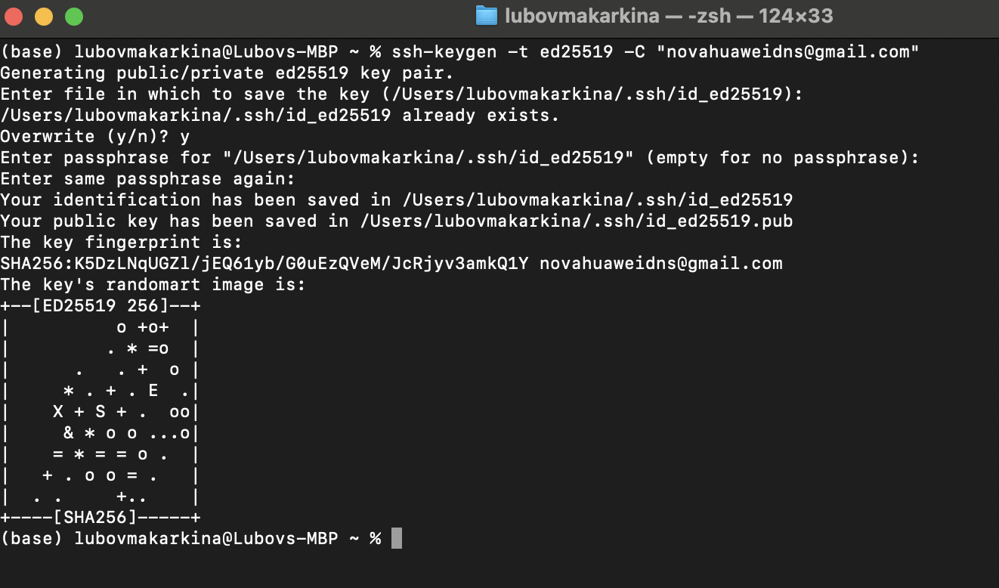
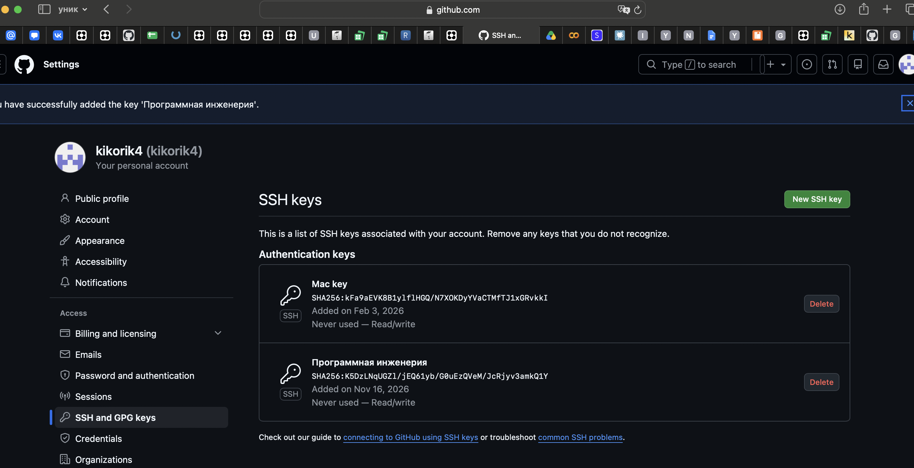
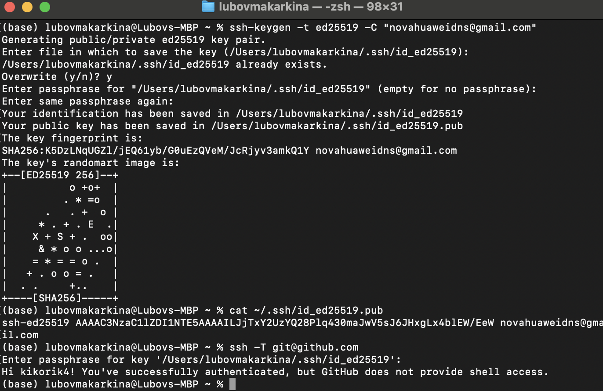
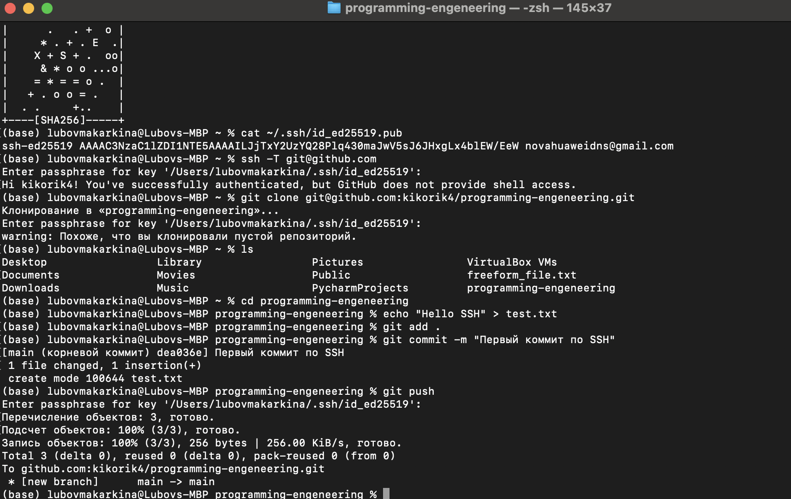

# Отчет по настройке SSH-доступа к GitHub

## 1. Генерация ключей
Была сгенерирована пара ключей типа ed25519 с защитой passphrase.
Команда: `ssh-keygen -t ed25519 -C "novahuaweidns@gmail.com"`

## 2. Добавление ключа на GitHub
Публичный ключ добавлен в настройки аккаунта.

## 3. Проверка подключения
Выполнена команда `ssh -T git@github.com`.

## 4. Работа с репозиторием
Репозиторий клонирован по SSH, создан коммит и выполнен `git push` без запроса пароля от GitHub.
